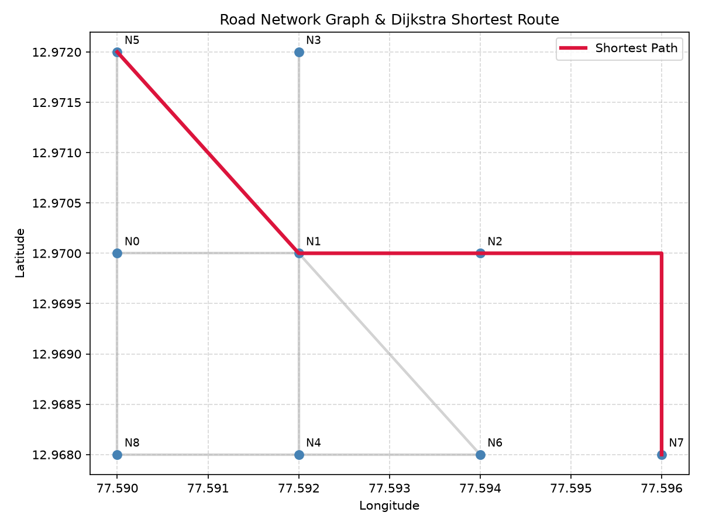

# Road Network Graph & Dijkstra Shortest Path

A Python tool and library that builds a weighted undirected road network graph from GeoJSON `LineString` features and calculates the shortest route between nodes using a from-scratch implementation of Dijkstra's algorithm.

---

## Table of Contents

- [Features & Architecture](#features--architecture)
- [Project Structure](#project-structure)
- [Prerequisites](#prerequisites)
- [Installation](#installation)
  - [Option 1: Using `uv` (Recommended)](#option-1-using-uv-recommended)
  - [Option 2: Using Standard `pip` & `venv`](#option-2-using-standard-pip--venv)
- [Usage](#usage)
  - [1. Run the Default Demo & Generate Plot](#1-run-the-default-demo--generate-plot)
  - [2. Import and Use in Your Own Python Script](#2-import-and-use-in-your-own-python-script)
  - [3. Use a Custom GeoJSON File](#3-use-a-custom-geojson-file)
- [Running Tests](#running-tests)
- [Sample Output & Visualization](#sample-output--visualization)

---

## Features & Architecture

1. **GeoJSON-to-Graph Importer (`build_graph_from_geojson`)**
   - Reads `LineString` road features from a `.geojson` file.
   - Uses **Shapely** (`intersection`, `split`, `transform`) to automatically detect shared road endpoints and interior intersections, splitting roads into individual graph edges.
   - Normalizes coordinates to 6 decimal places ($\approx 0.11\text{ m}$) so shared coordinates consistently merge into the same integer node ID.
   - Accounts for WGS84 `(longitude, latitude)` coordinates by projecting geometry into local metric space (meters) before computing segment lengths.

2. **Adjacency-List Dictionary Structure**
   - Stores the network as a Python dictionary mapping each `node_id` (`int`) to its `(lon, lat)` coordinate and outgoing edge list:
     ```python
     {
         0: {
             "coord": (77.59, 12.97),
             "edges": [
                 {
                     "to": 1,
                     "distance": 217.14,
                     "road_id": "R1",
                     "name": "Main Street",
                     "segment_coords": [(77.59, 12.97), (77.592, 12.97)]
                 },
                 ...
             ]
         },
         ...
     }
     ```

3. **From-Scratch Dijkstra Implementation (`dijkstra_shortest_path`)**
   - Uses a min-heap priority queue (`heapq`) to compute the shortest path by total road distance in meters.
   - Returns an ordered list of `(lon, lat)` coordinates from `from_node` to `to_node`.
   - Handles edge cases including identical source/destination nodes and unreachable/isolated nodes (returns `[]`).

---

## Project Structure

```text
road_graph_dijkstra/
├── main.py                 # Graph builder, Dijkstra algorithm, and Matplotlib visualizer
├── test_main.py            # Automated Pytest suite (valid route, same node, unreachable node)
├── road_network.geojson    # Sample synthetic WGS84 road network dataset (R1 - R6)
├── route_plot.png          # Generated visualization of the road network and shortest route
├── pyproject.toml          # Project metadata and dependency declarations
├── uv.lock                 # Exact dependency lockfile for reproducible environments
└── README.md               # Documentation
```

---

## Prerequisites

- **Python** `>= 3.10`
- **Git**
- **[uv](https://docs.astral.sh/uv/)** *(optional, recommended for fast setup)*

---

## Installation

First, clone the repository and navigate into the project directory:

```bash
git clone [https://github.com/](https://github.com/)<YOUR_GITHUB_USERNAME>/road-graph-dijkstra.git
cd road-graph-dijkstra
```

### Option 1: Using `uv` (Recommended)

If you don't have `uv` installed yet:

```bash
# Windows (PowerShell)
powershell -ExecutionPolicy ByPass -c "irm [https://astral.sh/uv/install.ps1](https://astral.sh/uv/install.ps1) | iex"

# macOS / Linux
curl -LsSf [https://astral.sh/uv/install.sh](https://astral.sh/uv/install.sh) | sh
```

Sync the virtual environment and install all locked dependencies (`shapely`, `matplotlib`, `pytest`):

```bash
uv sync
```

### Option 2: Using Standard `pip` & `venv`

If you prefer standard Python tooling:

```bash
# 1. Create a virtual environment
python -m venv .venv

# 2. Activate the virtual environment
# Windows (PowerShell):
.venv\Scripts\Activate.ps1
# Windows (CMD):
.venv\Scripts\activate.bat
# macOS / Linux:
source .venv/bin/activate

# 3. Install dependencies
pip install shapely matplotlib pytest
```

---

## Usage

### 1. Run the Default Demo & Generate Plot

Run `main.py` to build the graph from `road_network.geojson`, print the adjacency list, compute the shortest path from Node 5 `(77.59, 12.972)` to Node 7 `(77.596, 12.968)`, and save the visualization to `route_plot.png`:

```bash
# With uv
uv run main.py

# Or with activated venv
python main.py
```

### 2. Import and Use in Your Own Python Script

You can import `build_graph_from_geojson`, `dijkstra_shortest_path`, and `plot_route` directly in your own scripts to query routes between any two nodes:

```python
from main import build_graph_from_geojson, dijkstra_shortest_path, plot_route

# 1. Build the adjacency-list graph from GeoJSON
graph = build_graph_from_geojson("road_network.geojson")

# 2. Inspect available Node IDs and their (lon, lat) coordinates
for node_id, data in graph.items():
    print(f"Node {node_id}: {data['coord']}")

# 3. Calculate the shortest route between any two node IDs (e.g., Node 8 to Node 3)
route_coords = dijkstra_shortest_path(
    graph=graph,
    from_node=8,
    to_node=3,
)

print("Ordered Route Coordinates:", route_coords)

# 4. Save a custom plot of the route
plot_route(graph, route_coords, output_file="custom_route.png")
```

### 3. Use a Custom GeoJSON File

To run the algorithm on your own road network dataset, provide a `.geojson` file following the standard `FeatureCollection` format with `LineString` geometries in WGS84 `[longitude, latitude]`:

```json
{
  "type": "FeatureCollection",
  "features": [
    {
      "type": "Feature",
      "properties": {
        "road_id": "R1",
        "name": "Main Street"
      },
      "geometry": {
        "type": "LineString",
        "coordinates": [
          [77.590, 12.970],
          [77.592, 12.970]
        ]
      }
    }
  ]
}
```

Then pass your file path to `build_graph_from_geojson("path/to/your_network.geojson")`.

---

## Running Tests

The repository includes an automated `pytest` suite (`test_main.py`) covering:
- **Valid Route:** Multi-segment shortest path calculation across road intersections.
- **Identical Source & Destination:** Returns the single coordinate `[(lon, lat)]`.
- **Unreachable Destination:** Returns an empty list `[]` when no path exists.

Run the test suite with:

```bash
# With uv
uv run pytest -v

# Or with activated venv
pytest -v
```

---

## Sample Output & Visualization

```text
=== Built Adjacency-List Graph ===
Node 0 (77.59, 12.97) -> [(1, '217.14m', 'R1'), (5, '221.26m', 'R5'), (8, '221.26m', 'R5')]
Node 1 (77.592, 12.97) -> [(0, '217.14m', 'R1'), (2, '217.14m', 'R1'), (3, '221.26m', 'R2'), (4, '221.26m', 'R2'), (5, '310.01m', 'R3'), (6, '310.01m', 'R3')]
Node 2 (77.594, 12.97) -> [(1, '217.14m', 'R1'), (7, '438.4m', 'R4')]
Node 3 (77.592, 12.972) -> [(1, '221.26m', 'R2')]
Node 4 (77.592, 12.968) -> [(1, '221.26m', 'R2'), (8, '217.14m', 'R6'), (6, '217.14m', 'R6')]
Node 5 (77.59, 12.972) -> [(1, '310.01m', 'R3'), (0, '221.26m', 'R5')]
Node 6 (77.594, 12.968) -> [(1, '310.01m', 'R3'), (4, '217.14m', 'R6')]
Node 7 (77.596, 12.968) -> [(2, '438.4m', 'R4')]
Node 8 (77.59, 12.968) -> [(0, '221.26m', 'R5'), (4, '217.14m', 'R6')]

Shortest path from Node 5 to Node 7:
[(77.59, 12.972), (77.592, 12.97), (77.594, 12.97), (77.596, 12.97), (77.596, 12.968)]
```

### Generated Route Plot (`route_plot.png`)

